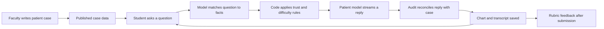

# Poscere: local setup and how it works

Set up October 11, 2026 from `CANTSOAR/lowhangingfruit26`; integrated Aryan’s main commits through `f693f69` with the existing local UI retained.
This is an independent Git checkout inside the existing `healthhacks26` folder.
The parent repository locally excludes this folder through `.git/info/exclude`.

## Open and run

Open <http://127.0.0.1:3100>. The production build is running locally on port 3100.
The current UI-refinement preview uses `.next-ui-comments`. Port 3114 is a separate
preview with a copied database and a synthetic patient-ended-call fixture; use 3100
for your saved work. The server binds to loopback. It is a local instance with its own database, separate
from the team's deployed prototype.

To run it again:

```sh
cd /path/to/lowhangingfruit26
NEXT_DIST_DIR=.next-ui-comments npm run start -- --hostname 127.0.0.1 --port 3100
```

For development, stop the running server first, then use:

```sh
cd /path/to/lowhangingfruit26
npm run dev -- --hostname 127.0.0.1 --port 3100
```

After code changes, `NEXT_DIST_DIR=.next-ui-comments npm run build` rebuilds the
production output used above. Development uses `.next` separately.
Dependencies were installed with `npm ci` from the existing lockfile, using
Node 26.0.0 and npm 11.12.1.

## Accounts and walkthrough

All four seeded local demo accounts use the public demo password `poscere-demo`.

| Email | Role |
|---|---|
| `faculty@poscere.demo` | Faculty / patient authoring |
| `student@poscere.demo` | Medical student |
| `dietetics@poscere.demo` | Dietetics student |
| `nursing@poscere.demo` | Nursing student |

As faculty, open **Patient Studio**, search for **Omar Sinclair**, and open the
case. You can inspect and edit its persona, facts, disclosure tiers, fixed exam
results, documents, objectives, answer key, and rubric. **Test visit** opens the
same encounter interface a student uses. Creating a new patient from a description
uses AI drafting; an existing case lets you explore immediately.

As a student, choose **Practice** or **Start adaptive visit**, read the waiting-room
brief, and join. Start with text input. The patient speaks on the left and the chart
is on the right. **Patient chart** contains newly learned history and the existing record; **Results**
contains returned exams and tests; **Documents** contains released reports. **Examine**
and **Order tests** request authored results.
End the visit, write the requested professional note, and submit for feedback.

**Care Journeys** has two seed journeys. A student chooses one professional role;
AI colleagues handle the other stages. Findings and handoffs carry forward to the
later visits, followed by team discussion and a coordinated plan.

## How the application works

One Next.js application serves both the React interface and backend routes. A local
SQLite file stores users, cases, transcripts, encounter state, feedback, courses,
and care journeys. There is no separate database server to start.



1. **Patients are data.** A `CaseProfile` contains the patient's personality,
   medical facts, exam results, documents, and learning goals. New patients do not
   require patient-specific code.
2. **Facts have disclosure rules.** Some are available immediately, some require
   a focused question, and some require trust. A fast model identifies which facts
   a question asks about and classifies communication signals. Deterministic code
   applies the fact tier, rapport score, and difficulty settings.
3. **The patient model supplies natural language.** It gets the persona, relevant
   encounter history, and information approved for the turn. Guarded facts being
   deflected are also supplied with instructions to withhold them, so disclosure
   still depends partly on model behavior.
4. **A second pass checks the reply.** The audit compares the answer against case
   facts, removes released facts that were not actually said, records true facts
   said early, and flags unsupported claims. This happens after the reply streams.
5. **Tests have authored results.** A model maps a request to an allowed action;
   code returns its stored result. Unsupported orders are recorded as unmatched.
6. **Feedback combines code and AI.** The ledger determines findings and actions
   elicited or missed. A model judges rubric performance. Code checks cited quotes
   against the transcript. Learner ratings then influence later recommendations.
7. **Care journeys reuse the encounter engine.** Shared patient-state entries
   record who contributed each finding, the encounter, and its supporting evidence.
   Links express confirmation, contradiction, updates, and resolution. SBAR means
   Situation, Background, Assessment, Recommendation.

## Main files

| Path | Responsibility |
|---|---|
| `src/app/`, `src/components/` | Pages, API routes, patient editor, visit screen |
| `src/lib/types.ts` | Case and encounter data structures |
| `src/lib/db.ts`, `src/lib/schema/` | SQLite tables and migrations |
| `src/lib/seed.ts` | Loads cases, clinicians, journeys, demo accounts on startup |
| `src/lib/casegen.ts`, `src/lib/studio/` | Patient drafting, editing, consistency checks |
| `src/lib/engine/gatekeeper.ts` | Question classification, disclosure policy, audit |
| `src/lib/engine/patient.ts`, `encounter.ts` | Patient prompt, turns, chart, actions |
| `src/lib/engine/feedback.ts` | Evidence-linked scoring and visit memory |
| `src/lib/journey/` | Multi-profession stages, shared state, handoffs, synthesis |
| `src/lib/llm.ts`, `src/lib/tts.ts` | Bedrock calls and patient speech |
| `data/seed/cases/`, `data/professions.json` | Seed cases and role catalog |

See `docs/ARCHITECTURE.md` and `docs/ARCHITECTURE-journeys.md` for the detailed design.

## AWS and local storage

Configure model access using the variables documented in `.env.example`, storing local values in ignored `.env.local`. Keep credentials and session secrets out of source control, screenshots and shared documents. Temporary AWS sessions may need refreshing before model or speech requests work. The browser microphone and camera are optional.

Local model and speech requests were verified during setup; that does not guarantee that a later account or expired session has access. The source's `src/lib/llm.ts` and `src/lib/tts.ts` define the supported providers and configuration.

The local database is `data/app.db`; uploads go to `data/uploads/`. Both are ignored.
Local verification artifacts are in `.local/`, excluded through this checkout's
`.git/info/exclude`. The seed library has 81 cases, 63 professional roles, five
clinician personas, and two journeys. All 81 cases are marked unreviewed.

## Verification and existing limitations

- Dependency installation, production build, and TypeScript checking passed.
- `/api/health` returned `ok: true` and 81 cases.
- Faculty and student sign-in, patient library, encounter waiting room, and both
  seed journey listings were verified in the browser.
- A student question produced a streamed patient reply and two chart findings
  through the running local server with workshop credentials.
- The repository engine smoke test passed: five turns and five patient replies,
  a recorded lipid-panel result, an unmatched brain-MRI order, and seven scored
  rubric domains. All nine returned evidence quotes matched stored transcript
  turns. This brief test verifies execution, not grading accuracy or clinical quality.
- The structural seed-library checker found zero errors, six warnings, and no
  professional roles without a case. Structural validation is not clinical review.
- Existing lint fails with 18 errors and 22 warnings. These are present in the
  upstream code; they do not prevent the verified build.
- `npm audit` reported five high-severity findings in the ESLint dependency chain.
  Its proposed automatic fix would downgrade the Next.js lint configuration across
  a major version; no dependency rewrite was performed as part of local setup.
- The build emits existing filesystem-tracing warnings around uploads and a warning
  about an unrelated ancestor lockfile. The local production server runs.
- Model-generated patient statements and grading are fallible. The audit runs
  after display, and the cases and scoring have not been clinically validated.

Engine smoke command, using a separate throwaway SQLite database:

```sh
npx tsx --env-file=.env.local scripts/sim-test.ts
```

The final smoke result is recorded in `.local/engine-smoke.log`.
