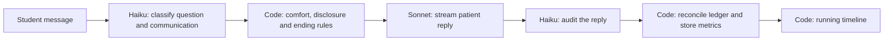

# Where AI content and scores come from

Source audit: October 11, 2026, local checkout. The model IDs below are the effective local configuration, checked with `.env.local` loaded. This audit did not call a provider or verify the deployed CloudFront environment or provider availability.

## Models

All application text LLM requests use AWS Bedrock through [`src/lib/llm.ts`](../src/lib/llm.ts). There are three wrappers: `chatText`, `chatStream`, and schema-constrained `chatJSON`. The last forces a tool response with the requested JSON schema.

| Code name | Locally configured ID | Main job |
| --- | --- | --- |
| `MODELS.fast` | `us.anthropic.claude-haiku-4-5-20251001-v1:0` | Question classification, action matching, reply audits, patient memory, short handoff summaries |
| `MODELS.chat` | `us.anthropic.claude-sonnet-4-5-20250929-v1:0` | Patient and colleague dialogue, notes and SBAR, clarification, missing case metadata |
| `MODELS.smart` | `us.anthropic.claude-sonnet-5` | Case generation, review and editing, grading, journey design, extraction and synthesis |

`MODEL_FAST`, `MODEL_CHAT`, and `MODEL_SMART` environment variables override these IDs. No overrides were present locally. The Sonnet 5 entry is a configured ID; it is not proof of a successful provider response. The deployment could have different overrides.

## Complete runtime text-generation map

| Feature | Generated or classified content | Model | Owning source |
| --- | --- | --- | --- |
| Case creation | Case plan, facts, approved actions/results, persona, scenario, objectives, answer key, documents; staged generation with a single-call fallback | smart | [`casegen.ts`](../src/lib/casegen.ts), `generateCase` |
| Case wizard | Clarifying questions and an understood description | chat | [`studio/ai.ts`](../src/lib/studio/ai.ts), `clarify` |
| Case review and editing | Consistency findings, explanations, suggested fixes/patches, guide replies, variants | smart | [`studio/ai.ts`](../src/lib/studio/ai.ts), `modelCheck`, `guide`, `draftVariant` |
| Missing case headers | Missing title, summary, specialty, setting and other metadata | chat | [`studio/ai.ts`](../src/lib/studio/ai.ts), `fillHeader` |
| Assignment guide | Proposed assignment setup, selected cases, instructions and reasons | smart | [`assignments/guide/route.ts`](../src/app/api/assignments/guide/route.ts) |
| Journey builder | Proposed stages, roles, encounter briefs and journey summary | smart | [`journey/guide.ts`](../src/lib/journey/guide.ts), `proposeStages` |
| Interview controller | Question type, matched fact IDs, communication signals and short emotion label | fast | [`engine/gatekeeper.ts`](../src/lib/engine/gatekeeper.ts), `gatekeep` |
| Patient dialogue | Streamed patient words for each turn | chat | [`engine/encounter.ts`](../src/lib/engine/encounter.ts), `runTurn`; prompt in [`engine/patient.ts`](../src/lib/engine/patient.ts) |
| Exams and tests | Maps the requested action to approved action IDs; does not invent the result | fast | [`engine/gatekeeper.ts`](../src/lib/engine/gatekeeper.ts), `matchActions` |
| Patient reply audit | Flags unsupported statements and facts conveyed/not conveyed | fast | [`engine/gatekeeper.ts`](../src/lib/engine/gatekeeper.ts), `auditReply` |
| End-of-visit feedback | Rubric scores, evidence, rationales, strengths/gaps, objectives, interview and wrap-up feedback | smart | [`engine/feedback.ts`](../src/lib/engine/feedback.ts), `scoreEncounter` |
| Repeat-visit memory | Short patient relationship/visit memory stored for later visits | fast | [`engine/feedback.ts`](../src/lib/engine/feedback.ts), `rememberVisit` |
| AI clinician visits | Clinician questions, closing words, clinical note and SBAR handoff; patient replies still use the same encounter engine | chat | [`journey/clinician.ts`](../src/lib/journey/clinician.ts), `runAiVisit`, `writeNoteAndHandoff` |
| Shared patient state | Interprets a clinician's visit/note into supported recommendations, interpretations and plans | smart | [`journey/extract.ts`](../src/lib/journey/extract.ts), `extractStage` |
| Shared-state links | Checks whether a proposed relationship connects the same clinical subject | chat | [`journey/extract.ts`](../src/lib/journey/extract.ts), `verifyLinks` |
| Team conversations | Consult replies, call-out readbacks, huddle responses, negotiated plan changes | chat | [`journey/collab.ts`](../src/lib/journey/collab.ts) |
| Huddle preparation | Discussion agenda and initial colleague positions | smart | [`journey/collab.ts`](../src/lib/journey/collab.ts), `startHuddle` |
| Handoff/team evaluation | Behavioral evaluation and feedback from SBAR or the full student trace; short summary recomputed from verified behaviors | smart; fast summary | [`journey/handoff.ts`](../src/lib/journey/handoff.ts), `evaluateSbar`, `evaluateStudent` |
| Integrated plan | Patient summary, problems, patient goals, plan actions and rationales from the shared state | smart | [`journey/synthesis.ts`](../src/lib/journey/synthesis.ts), `synthesise` |

Saved cases and seeded journeys are reused when pages load. They may be faculty-authored, imported, seeded, or previously AI-generated; a visible paragraph alone does not establish its authorship. Faculty/user edits, student messages, exact source quotes and editor textareas retain their source values.

The maintenance scripts [`scrub-briefs.ts`](../scripts/scrub-briefs.ts) and [`check-library.ts`](../scripts/check-library.ts) also use the text wrappers; these are explicit utilities, not page-render calls. Portraits use a separate image model: [`portrait.ts`](../src/lib/portrait.ts) defaults to `stability.sd3-5-large-v1:0` with `MODEL_IMAGE` override; the batch [`gen-portraits.ts`](../scripts/gen-portraits.ts) uses `PORTRAIT_MODEL`. [`tts.ts`](../src/lib/tts.ts) synthesizes existing words through ElevenLabs with Polly fallback. Image generation and speech synthesis are separate from the three text LLM roles above.

## What happens on every interview turn

The decision system combines an LLM classifier and deterministic policy. It is not a separate trained clinical outcome/decision model. Haiku labels the student's utterance; code decides what those labels mean for patient comfort and fact release. See `gatekeep` and `decide` in [`gatekeeper.ts`](../src/lib/engine/gatekeeper.ts).

Examples of comfort changes: empathy +6, emotional validation +5, sensitive framing +5, an open question +2, judgmental wording −10, dismissiveness −7, and unexplained jargon −2 (−5 for low literacy). Introduction +4 and purpose +3 receive credit only once early in the interview. The turn's net change is capped at ±12; total comfort is clamped to 0–100. Difficulty, fact tier, question directness and trust thresholds determine disclosure. [`ending.ts`](../src/lib/engine/ending.ts) calculates whether the patient ends the call. The LLM writes the goodbye.

The reply audit runs **after streaming**, so it is not a guarantee that an unsupported statement was blocked before the learner saw it. The code reconciles the disclosure ledger from the audit and records the result.

Question/communication counts, disclosure coverage and comfort history are stored per turn. [`timeline.ts`](../src/lib/engine/timeline.ts) calculates a running score without an extra LLM call:

`running score = 45% coverage pace + 35% smoothed communication + 20% comfort`

Coverage weights critical/important/minor findings 3/2/1, includes key approved exams, and excludes information visible at the start. Pace compares coverage with a target of 80% by turn 12. Communication uses the classified signals and an exponential average. This running score is a heuristic, distinct from the final rubric grade.

After submission, smart-model grading produces rubric scores and feedback. Code checks score ranges, grounds quoted evidence and counts findings from the ledger. [`adaptive.ts`](../src/lib/adaptive.ts) then updates persistent skill ratings with Elo-style arithmetic and chooses the next difficulty based on expected success around 70%. No extra LLM chooses that rating update. Practice hints in [`encounter.ts`](../src/lib/engine/encounter.ts), `hint`, are also rule-based.

## How `**...**` emphasis works now

The shared instruction in [`text-format.ts`](../src/lib/text-format.ts) asks all three text wrappers for 1–3 short, grounded emphasized phrases per paragraph of learner/faculty prose. This covers dialogue, briefs, summaries, explanations, feedback and plans. The instruction forbids adding clinical facts or coaching hints just to emphasize something. Internal classifiers, action matching, audits, exact-match link checking and patient memory explicitly opt out where appropriate.

Markers are allowed only in human-facing prose strings. IDs, enums, keys, names, titles, numeric values, canonical facts/results, action requests, exact evidence quotes and patch values must stay exact. Editable source textareas intentionally show the underlying markers.

[`GeneratedText.tsx`](../src/components/learning/GeneratedText.tsx) renders balanced double-asterisk phrases as bold text, using escaped React nodes rather than raw HTML. It is used for patient/colleague dialogue, journey state, SBAR, integrated plans and faculty guide/review prose. [`FeedbackText.tsx`](../src/components/learning/FeedbackText.tsx) already interprets emphasis and rubric highlight metadata. [`SmartHighlights.tsx`](../src/components/learning/SmartHighlights.tsx) now recognizes model markers as bold; turning Highlights on also gives them a blue background. Existing phrase matching remains a fallback for older briefings, and glossary terms remain a separate dictionary mechanism.

Speech strips the formatting markers while keeping every emphasized word. Single-asterisk stage cues are handled separately; they are omitted from speech. Tests cover both complete and partial streamed emphasis, safe rendering, and the common prompt/opt-out behavior with mocked SDK calls.

This is a consistent request and rendering contract, not a guarantee that a probabilistic model always follows it. Unmarked text remains readable, and existing saved content is not regenerated. No paid LLM or speech calls were made to validate this change.
